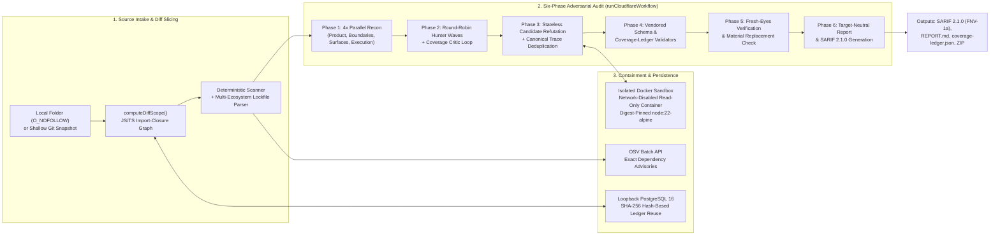

# Kavach

**Project Security Review · Find risks. Verify evidence.**

Kavach is a local-first static and model-assisted application security review engine. It audits local repositories or public HTTPS Git checkouts using the six-phase adversarial workflow from [Cloudflare’s `security-audit` skill](https://github.com/cloudflare/security-audit-skill), runs candidate-specific reproduction probes inside network-isolated read-only Docker sandboxes, checks exact lockfile dependency versions against [OSV](https://google.github.io/osv.dev/post-v1-querybatch/), and exports SARIF 2.1.0, Markdown, printable PDF, and validated coverage ledgers.

## System Architecture



## Key Engineering Highlights

| Subsystem | Implementation | Security & Engineering Invariant |
|---|---|---|
| **Six-Phase Adversarial Pipeline** ([`cloudflare-skill-runner.mjs`](cloudflare-skill-runner.mjs)) | Stateless role separation across Reconnaissance, Hunting, Critic Waves, Refutation, Schema/Ledger Validation, and Fresh-Eyes Verification | Source-only hunters can never emit `confirmed` findings; canonical `entrypoint -> sink` trace hashing deduplicates multi-class hits before Phase 3 refutation |
| **Contained Candidate Probes** ([`docker-sandbox.mjs`](docker-sandbox.mjs)) | Digest-pinned `node:22-alpine` containers with network disabled, read-only rootfs, dropped Linux capabilities, `16 MB` scratch `tmpfs`, `256 MB` RAM, and `32` PIDs | Target code and model-generated probes never access host networks, credentials, or writable source trees; parent promotes bounded stdout only after container exit |
| **Incremental PR Diff & Import Closure** ([`server.mjs`](server.mjs)) | `computeDiffScope()` parses static JS/TS imports and reverse importers across `git diff <base>...<head>` | Reuses SHA-256-verified `covered` ledger units on unchanged paths and fails closed to `full_reaudit` on config/lockfile changes, deleted files, dynamic imports, or >250 impacted files |
| **TOCTOU-Safe Local Collector** ([`server.mjs`](server.mjs)) | `collectLocalDirectory()` opens regular files with `O_NOFOLLOW` and verifies `lstat`/`fstat` `(dev, ino)` parity | Prevents symlink-swap traversal outside the target repository root during local filesystem or CLI scans |
| **CI/CD & SARIF 2.1.0 Export** ([`kavach-cli.mjs`](kavach-cli.mjs), [`public/sarif.mjs`](public/sarif.mjs), [`action.yml`](action.yml)) | Headless CLI (`kavach`), composite GitHub Action, and [GitHub Code Scanning workflow](.github/workflows/kavach-audit.yml) | Emits 64-bit FNV-1a `partialFingerprints` (`kavach/v1`), maps `confirmed` to `error` and `needs_validation` to `warning`, and enforces exit codes `0` / `1` / `2` / `3` |

## Paired-Fixture Benchmark Suite

[`benchmarks/fixtures.mjs`](benchmarks/fixtures.mjs) and [`benchmarks/run.mjs`](benchmarks/run.mjs) evaluate 25 paired vulnerable/patched JavaScript fixtures (50 files) across five vulnerability classes (`sql-injection`, `ssrf`, `path-traversal`, `command-injection`, and `prototype-pollution`), measuring how Phase 2–5 trace attribution eliminates false positives produced by pattern matching on patched controls:

| Stage | Candidates | Precision | Recall | F1 | False Positives | False Negatives |
|---|---:|---:|---:|---:|---:|---:|
| **Deterministic regex baseline (Phase 0)** | 17 | 82.4% | 56.0% | 0.667 | 3 | 11 |
| **Hunt (Phase 2, pilot quick run)** | 2 | 100.0% | 4.0% | 0.077 | 0 | 24 |
| **Refutation (Phase 3, pilot quick run)** | 2 | 100.0% | 4.0% | 0.077 | 0 | 24 |
| **Independent verification (Phase 5, pilot quick run)** | 2 | 100.0% | 4.0% | 0.077 | 0 | 24 |

- **Deterministic-to-Phase-5 false-positive reduction:** **100.0%** (`3` false positives on patched fixtures reduced to `0` after trace-grounded refutation; see [`benchmarks/results/codex-quick.md`](benchmarks/results/codex-quick.md) and [`benchmarks/results/deterministic-baseline.md`](benchmarks/results/deterministic-baseline.md)).
- Reproduce the deterministic baseline in `<50ms` or run a full model-backed benchmark:

```sh
npm test
node benchmarks/run.mjs --deterministic-only --out benchmarks/results/deterministic-baseline.json
npm run benchmark -- --provider ollama --model qwen3:8b --runs 3 --out benchmarks/results/qwen3.json
```

## Start Kavach

Requirements: Node.js 22 or newer, Git, Docker Desktop (or a local Docker Engine), and a modern browser.

1. Copy `.env.example` to `.env`. The Firebase settings point to the existing `matrix-abacus` project. Keep `DATABASE_URL`’s password in sync with `POSTGRES_PASSWORD` if you change it.
2. Start the local PostgreSQL database:

   ```sh
   docker compose up -d postgres
   ```

   This exposes PostgreSQL only on `127.0.0.1:54329`. If a local PostgreSQL server is already running, set `DATABASE_URL` to its loopback address instead.

3. Install the app packages once, then start the workspace:

   ```sh
   npm install
   npm start
   ```

4. Open [http://localhost:4173](http://localhost:4173). Create a Firebase account, verify its email, then sign in.

The server binds only to `127.0.0.1`. Firebase Authentication and Firestore are accessed through their REST APIs; no service-account key is required.

## Firebase Auth and Firestore

Email/password sign-in uses Firebase Authentication for project `matrix-abacus`. Accounts must verify their email. The browser keeps the Firebase sign-in session for the current browser session, and the local server verifies Firebase ID tokens before giving access to PostgreSQL history or starting a review. A pending review ID is kept in tab session storage so the same account can resume polling after signing in again; no token or source files are stored there.

Firestore stores one small preferences document per account at `fieldnoteProfiles/{uid}`. It contains only the selected model settings and review options. The rules allow an email-verified user to read and update only their own preferences; every other document path remains denied. Source files, findings, reports, and Git addresses are not written to Firestore.

PostgreSQL stores review reports, findings, coverage, and audit artifacts in a local Docker volume. Each record is scoped to the authenticated Firebase UID. Project source files are not saved to PostgreSQL.

## Docker checks

The app never downloads a sandbox image automatically. Start Docker Desktop, then fetch the Node image once if it is not already installed:

```sh
docker pull node:22-alpine
```

Kavach checks that Docker is connected to a local Unix socket and pins each run to the locally installed image’s content ID. It discovers up to eight existing `*.test.js`, `*.test.mjs`, `*.test.cjs`, `*.spec.js`, `*.spec.mjs`, or `*.spec.cjs` files. Each selected test runs by itself with no network, an empty allowlisted environment, a read-only staged source tree, a read-only container filesystem, a 64 MB scratch tmpfs, no extra Linux capabilities, a non-root user, and memory, CPU, process, per-file, output, and time limits. Git’s temporary checkout and Docker’s staged source share one 100 MB host workspace cap; Docker checks are marked blocked if staging would exceed the remaining space. Temporary checkout and staging files are removed after report generation or when the Docker test run finishes. It never runs package installation, project scripts, builds, or arbitrary Git hooks.

When Docker is selected and ready, Phase 3 can also ask a fresh selected-model role for a self-contained Node.js probe for up to eight candidates. Each probe runs in its own offline container with a read-only source mount, a 16 MB scratch tmpfs, 256 MB memory, one CPU, 32 processes, 16 KB script limit, 96 KB output limit, and a 12 second time limit. The parent process writes a bounded evidence record only after the container exits. A probe must complete successfully with nonempty, untruncated output before a candidate may be confirmed; every result still receives the independent Cloudflare workflow review. Candidates that need dependencies, other language runtimes, builds, or deployment facts remain `needs_validation`. A passing test or probe does not certify that a project is safe.

The Compose PostgreSQL service uses a loopback-only port (`127.0.0.1:54329`) and a persistent Docker volume. The Node sandbox does not receive the Docker socket or a mount of the original project folder.

## Model providers

Choose Ollama, Apple MLX, Apple Foundation Models, Codex CLI, or Gemini CLI in the workspace. Ollama, MLX, and Apple Foundation Models list models from loopback servers. The Apple Foundation Models gateway uses `http://127.0.0.1:11437/v1` and the model `apple-fm`. Codex CLI and Gemini CLI use the sign-in already configured in those command-line tools; Kavach does not request or store model API keys. Run `codex login` and sign in with ChatGPT, or run `gemini` and sign in with Google, then select that CLI in Kavach. Codex's login status is checked before scanning. Gemini CLI installation is checked before scanning and its sign-in is checked when a review begins.

- Ollama: `http://127.0.0.1:11434`
- Apple MLX: `http://127.0.0.1:8080`
- Apple Foundation Models: `http://127.0.0.1:11437`
- Codex CLI: `codex exec` in a temporary working directory with read-only sandboxing and ephemeral session mode.
- Gemini CLI: `gemini --prompt` in a temporary working directory with plan mode; Kavach requests deletion of its temporary local session after each call.

With Ollama or MLX, selected source excerpts and audit prompts go to the local loopback model server. With Codex CLI or Gemini CLI, selected excerpts are passed to that tool for processing under its signed-in account. The complete repository is not placed in the CLI working directory. Do not send source to a provider unless its account terms allow it. The report records which CLI was used and where prompts were processed. Provider quotas, terms, and usage limits apply. Gemini CLI may keep local session records until its deletion command completes.

Model requests have a five-minute default timeout. Set `FIELDNOTE_LOCAL_MODEL_TIMEOUT_MS` to adjust it from 30 seconds to 10 minutes. Ollama requests use an 8,192-token context by default; set `FIELDNOTE_OLLAMA_NUM_CTX` from 2,048 to 65,536 to match the available memory and model. Reconnaissance uses Ollama's JSON-schema response format and retries a response once when it is malformed or omits required, source-grounded fields. Each retry counts against the selected audit call cap. The same repair attempt is available for malformed JSON from the CLI providers.

The six-phase review is marked incomplete when the selected CLI or local model is unavailable, not signed in, or fails to complete a phase. The app does not download models or start model servers. CLI use may avoid managing an API key in Kavach, but it is not guaranteed to be faster; startup time, provider load, rate limits, and the multi-call audit all affect duration.

## Full Cloudflare workflow

1. **Reconnaissance:** four fresh selected-model role calls map product and stack, principals and trust boundaries, source entry surfaces and sinks, and safe local checks. Kavach also loads prior runs for the same source, compares per-file SHA-256 hashes, and selects applicable Cloudflare companion guidance.
2. **Coverage-led hunting:** create a ledger from source surfaces, boundaries, subsystems, and attack classes. Stateless hunting roles review bounded source context. Coverage critics record gaps and reassign work. Standard and Deep profiles repeat waves until a distinct final-clean critic accepts the ledger or a strict limit leaves it incomplete. Quick uses one wave and one final critic.
3. **Candidate validation:** a fresh role rereads each candidate and tries to refute its source trace. When Docker is selected and ready, a separate role may generate a bounded Node.js probe for up to eight candidates; the parent captures its result and promotes a report artifact after the container exits. A prior confirmed record is rechecked against current source and local evidence. Quick mode uses the same fresh verifier for Phase 3 and Phase 5, as the Cloudflare profile requires. Unavailable runtime or deployment facts remain explicit blockers.
4. **Structured output:** validate findings against the vendored Cloudflare schema and run Cloudflare’s official findings and coverage-ledger validators after state changes.
5. **Independent verification:** Standard and Deep use a separate fresh role to check every retained record against current source and evidence. A material replacement receives another fresh verification and schema validation.
6. **Target-neutral reporting:** the selected model provider writes a posture and coverage summary from validated facts. Kavach generates `run-metadata.json`, `architecture.md`, `coverage-ledger.json`, `findings.json`, `REPORT.md`, `FINDINGS-DETAIL.md`, and `NEEDS-VALIDATION.md`.

Choose Quick, Standard, or Deep and a strict call cap from 12 to 512. Defaults are 48, 128, and 256 calls. The run never exceeds its configured cap; any deferred unit, unresolved candidate, failed validator, unavailable prior-run comparison, or incomplete phase is reported as incomplete. Previous runs are scoped to the signed-in Firebase user and source identity in PostgreSQL.

Reviewer roles are fresh, stateless prompts sent to the same selected model provider. They are not separate delegated model agents. Only candidate-specific Node.js probes and selected existing tests run as target code, inside the bounded local Docker configuration described above. Kavach promotes only parent-captured output and metadata; it does not implement the Cloudflare skill’s per-role scratch-directory handoff. Source-only leads and checks that need unavailable dependencies or runtime facts remain `needs_validation`.

For Git intake, Kavach creates a shallow partial clone without checking out the full repository, reads tree metadata, and fetches only eligible files within the 100 MB review cap. The clone and any Docker source staging share a 100 MB temporary workspace budget. Temporary files are deleted automatically after report generation or when a scan stops with an error.

Dependency inputs include npm, Python, Rust, Go, Ruby, PHP, Java/Gradle/Maven, and NuGet manifests and lockfiles. OSV receives package names, ecosystems, and exact versions only when online lookup is selected. The project source stays on this device except for selected excerpts sent to the model provider you choose.

## Headless CLI and GitHub Code Scanning

The CLI uses the same scan pipeline without starting the web server or Firebase authentication. PostgreSQL history stays off by default; `--postgres-cache` opts local-folder scans into hash-based reuse with a PostgreSQL service on this device. The CLI reads local folders without following symlinks, skips special files, and uses the same file-count, file-size, and total-size limits as the workspace.

```sh
node kavach-cli.mjs scan . --sarif out.sarif.json --fail-on confirmed
node kavach-cli.mjs scan . --provider ollama --model qwen3:8b --docker-probes --output-dir out/kavach
```

`--fail-on confirmed` fails for verified source findings and exact affected dependency versions returned by OSV. Deterministic source leads remain SARIF warnings and do not satisfy that threshold. `--require-complete` also returns exit code 3 when the six-phase workflow did not complete. Without a model provider, Kavach still runs deterministic checks and labels the six-phase review incomplete; it never presents that as a completed AI review. Model output, OSV package/version requests, and Docker probes are optional and are controlled by explicit flags.

`action.yml` provides a composite action. `.github/workflows/kavach-audit.yml` demonstrates SARIF artifact retention and upload to GitHub Code Scanning. Upload requires `security-events: write` and a repository where Code Scanning is available. Fork pull requests keep the SARIF artifact but skip upload because their default token cannot write code-scanning results. The workflow does not use `pull_request_target` or run repository code in Docker. GitHub-hosted runners cannot reach a developer’s loopback Ollama or MLX service; configure a self-hosted runner or another explicit provider for model-assisted CI. See [GitHub’s SARIF upload guide](https://docs.github.com/en/code-security/how-tos/find-and-fix-code-vulnerabilities/integrate-with-existing-tools/upload-sarif-file) and [fork workflow restrictions](https://docs.github.com/en/actions/reference/workflows-and-actions/events-that-trigger-workflows).

## Incremental scans and benchmarks

Use either a portable JSON baseline or `--postgres-cache` to load prior coverage, then run `--diff <base>...<head>` on a clean local Git checkout whose `HEAD` matches `<head>`:

```sh
node kavach-cli.mjs scan . --provider ollama --model qwen3:8b --save-baseline .kavach/baseline.json
node kavach-cli.mjs scan . --provider ollama --model qwen3:8b --diff origin/main...HEAD --baseline .kavach/baseline.json --save-baseline .kavach/baseline.json
node kavach-cli.mjs scan . --provider ollama --model qwen3:8b --postgres-cache
node kavach-cli.mjs scan . --provider ollama --model qwen3:8b --diff origin/main...HEAD --postgres-cache
```

Kavach uses SHA-256 source hashes and prior coverage records to reuse unchanged, fully covered units only when the profile, provider/model, budget, workflow revision, and engine revision match. Changed paths and their JavaScript/TypeScript import closure are re-audited. Configuration changes, deleted paths, unresolved or dynamic imports, unsupported changed languages, and large dependency closures fall back to a full re-audit. The report records the selected diff and its fallback reason. Baseline files and SARIF output default to the ignored `.kavach/` directory so later scans do not analyze prior artifacts.

The paired benchmark corpus contains 25 vulnerable/patched JavaScript fixtures across SQL injection, SSRF, path traversal, command injection, and prototype pollution. It records per-phase findings for Hunt, Refutation, and Independent Verification and scores precision, recall, F1, false positives, and false negatives by class.

```sh
npm run benchmark -- --provider ollama --model qwen3:8b --runs 3 --out benchmarks/results/qwen3.json
```

Run the benchmark only with a model/provider you intend to evaluate. It makes real model calls; `--docker-probes` additionally runs candidate-specific checks only when Docker and the pinned image are already available. The 25-pair corpus is an initial pilot, not evidence of broad ecosystem coverage.

## Scope limits

- Folder scans read up to 8,000 files and 100 MB, skipping common generated folders, binaries, symlinks, and individual files above 1 MB. Git checkout and Docker staging share a temporary workspace capped at 100 MB. Temporary source copies are removed after report generation, including when a review fails.
- Git scans accept public HTTPS repositories from GitHub, GitLab, or Bitbucket and fetch a shallow snapshot without submodules.
- A source-only review is not a certification and cannot prove that no vulnerabilities remain. A complete six-phase workflow means every procedural phase completed for the reported scope; it does not imply runtime validation or prove safety.

## References

- [Cloudflare security-audit-skill](https://github.com/cloudflare/security-audit-skill) (vendored at commit `c1c8a8c1471069fb0e188eeaff69b8e8db6564a8`)
- [Firebase Authentication](https://firebase.google.com/docs/auth)
- [Firestore security rules](https://firebase.google.com/docs/firestore/security/get-started)
- [Docker container run reference](https://docs.docker.com/engine/containers/run/)
- [Ollama API](https://docs.ollama.com/api/chat)
- [MLX-LM HTTP model server](https://github.com/ml-explore/mlx-lm/blob/main/mlx_lm/SERVER.md)
- [Codex CLI non-interactive mode](https://developers.openai.com/blog/codex-as-a-platform)
- [Gemini CLI authentication](https://github.com/google-gemini/gemini-cli/blob/main/docs/get-started/authentication.mdx)
- [Gemini CLI headless mode](https://github.com/google-gemini/gemini-cli/blob/main/docs/cli/tutorials/automation.md)
- [OSV batch query API](https://google.github.io/osv.dev/post-v1-querybatch/)
